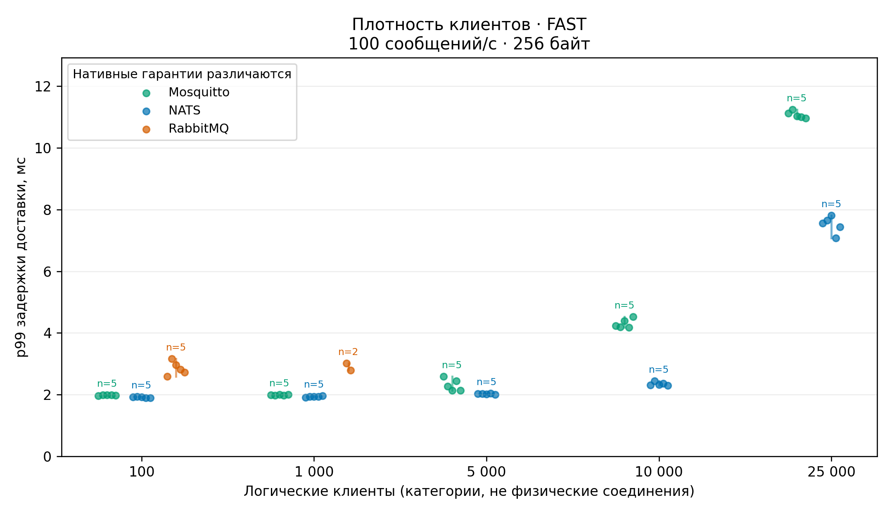
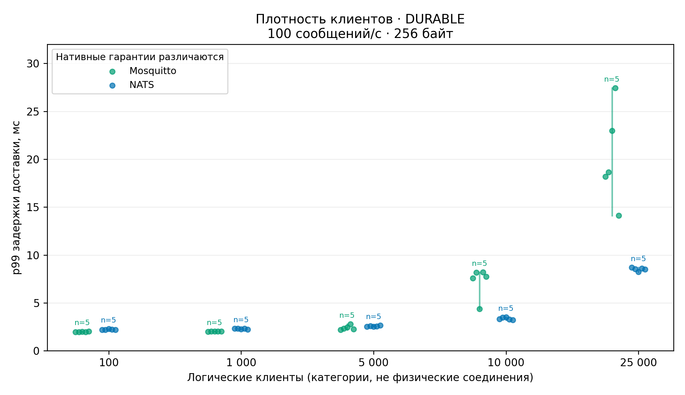
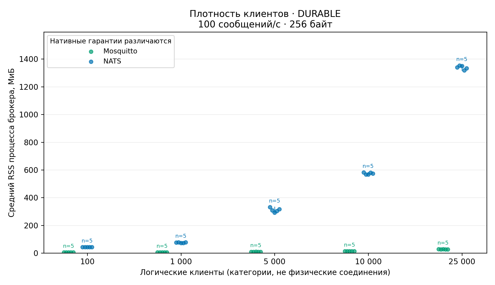
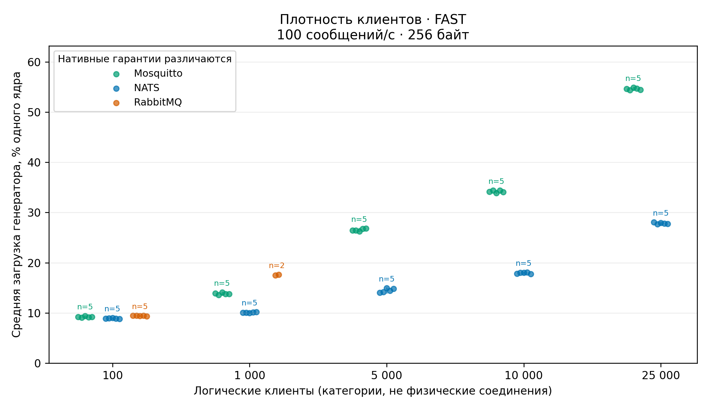
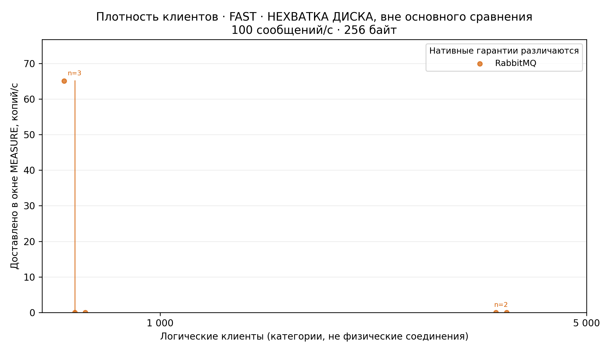

# Message Broker Research Framework

Единый Go runner и Python analysis для воспроизводимых экспериментов с NATS,
Mosquitto, RabbitMQ и Kafka. Источники истины — YAML scenario, manifest,
конфигурации, JSONL measurements и HDR distributions. Таблицы и PNG/SVG производны.

## Базовые результаты srv0

[Полный отчёт](reports/baseline-srv0-20261109/README.md) ·
[Таблицы](reports/baseline-srv0-20261109/tables.md) ·
[Все 35 графиков и SVG](reports/baseline-srv0-20261109/charts.md) ·
[Исходные данные и SHA-256](https://github.com/AlexandrShapkin/message-broker-benchmark/releases/tag/baseline-srv0-20261109-v1) ·
[Восстановление из GitHub](docs/restore.md)

Измерения 1–4 октября 2026 года исследуют **плотность клиентов при фиксированной
нагрузке**, а не максимальную пропускную способность. На srv0 (i3-9100F, 4 ядра,
около 30,27 ГиБ RAM) работали брокер и генератор: один активный producer,
один consumer, остальные клиенты держали транспорт. Нагрузка — 100 сообщений/с,
полный envelope 256 байт; warmup/измерение/cooldown — 60/300/30 с.

Обнаружено 290 попыток. Основная серия содержит **107 проверенных запусков
в 22 группах**. Пять completed RabbitMQ runs с disk alarm показаны отдельно;
[реестр всех попыток](reports/baseline-srv0-20261109/run-register.csv) объясняет
все исключения, включая failed, incomplete, smoke и synthetic.
Точки ниже — отдельные запуски, отрезки — min–max внутри строгой группы,
`n` — число повторов. Категории по горизонтали расположены равномерно.
FAST и DURABLE — нативные профили с [разными гарантиями](docs/brokers.md).

### Задержка доставки: FAST



При росте со 100 до 25000 клиентов per-run p99 NATS увеличился с
1,896–1,932 до **7,083–7,811 мс**, Mosquitto — с 1,965–1,994 до
**10,959–11,247 мс**; по пять повторов на каждой точке. Задержка отсчитывается
от планового времени отправки и включает очередь/scheduling lag.
Это диапазоны p99 отдельных запусков, не p99 объединённого потока.
RabbitMQ без disk alarm представлен только при 100 и 1000 клиентах.

### Задержка доставки: DURABLE



На 25000 клиентах p99 NATS составляет **8,239–8,703 мс**, Mosquitto —
**14,127–27,423 мс**. У Mosquitto в этой точке шире разброс между повторами.
JetStream с publish/consumer ack и MQTT QoS1 с persistent session не обеспечивают
одинаковую persistence/fsync-семантику; из графика нельзя вывести универсальное
превосходство одного брокера при эквивалентных гарантиях.

### Память процесса брокера



На 25000 клиентах средний RSS NATS DURABLE — **1318–1353 МиБ**, Mosquitto —
**27,2–27,6 МиБ**. Это память выбранного broker process в данных конфигурациях,
а не весь footprint системы. Для оценки общего бюджета нужны также память
генератора, page cache и cgroup; показатели генератора есть в таблицах.

### Стоимость генерации нагрузки



На 25000 клиентах FAST средняя загрузка генератора составляет **27,7–28,1% одного
ядра** для NATS и **54,3–54,9%** для Mosquitto. Одинаковый прикладной rate
не означает одинаковую стоимость client library и служебного трафика.
В основной серии offering path выдержал заданные 100 сообщений/с без queue drops;
это не калибровка его максимальной производительности.

### RabbitMQ при нехватке диска



В пяти completed-запусках broker log фиксирует disk alarm и блокировку publishers.
Два запуска при 5000 клиентах не доставили ни одной копии. Суммарно эти пять
наблюдений содержат **127776 недоставленных копий, 192 ошибки операций и 2715
queue drops**. Ещё девять failed-попыток финальной серии содержат ENOSPC.
[Наблюдения сохранены отдельно](reports/baseline-srv0-20261109/observations.md):
это влияние заполнения диска, **не доказанный предел плотности RabbitMQ**.

### Что следует из результатов

- NATS и Mosquitto завершили по 50 финальных запусков до 25000 логических клиентов
  в FAST/DURABLE при 100 сообщениях/с без потерь, duplicates и ошибок операций.
  При росте плотности увеличиваются задержки и расходы ресурсов; профиль,
  процесс брокера и генератор нужно рассматривать отдельно.
- Во всех 107 основных запусках offered, accepted и delivered rates равны 100/с,
  queue drops нулевые. Проверенный максимум TCP endpoints совпадает с числом
  логических клиентов; выборки не доказывают непрерывность каждого соединения.
- Данные RabbitMQ при нехватке диска не позволяют оценить его максимальную
  плотность. Финальные Kafka, RabbitMQ DURABLE, rate/payload/recovery серии
  отсутствуют; пилоты их не заменяют.
- Будущий брокер должен воспроизвести workload, среду и явные нативные гарантии.
  [Контракт сравнения](reports/baseline-srv0-20261109/COMPARISON.md) фиксирует ключи,
  единицы и per-run таблицы; latency потерянных сообщений не выдумывается.

После проверенной публикации benchmark удалён с srv0: освобождено **61,35 ГБ**.
[Журнал очистки](reports/baseline-srv0-20261109/CLEANUP.md) содержит фактические
проверки. Для чтения результатов и восстановления данных исходный сервер не нужен.

## Восстановление и архивы

Исходники, отчёт и ключевые графики находятся в Git. Raw data, образы брокеров,
полные таблицы и вспомогательная история сохраняются в versioned GitHub Releases.
[Инструкция восстановления](docs/restore.md) описывает чистый clone, проверку
архивов, пересчёт baseline и восстановление локальных acceptance-материалов.
Сентябрьские проверки инфраструктуры отделены от научной серии srv0.

## Быстрый запуск новых экспериментов

Реальные Docker smoke-запуски всех четырёх брокеров проверяют доставку, raw data,
manifest, ресурсы и построение таблиц/PNG/SVG. Текущие проверки и доказательства
собраны в [TASKS.md](TASKS.md). Перед финальным исследованием выполните
[процедуру проверки](docs/experiment-procedure.md) и учтите [ограничения](docs/limitations.md).

Требуются Linux, Go 1.27, Python 3.14 с venv, Docker Engine 25+ и Compose 2.20.2+, доступ
к registry. Docker должен быть доступен текущему пользователю. Framework не
меняет OS configuration, swap, governor или ulimit.

```bash
# Клонируйте этот repository и перейдите в его каталог.
make bootstrap build
export PATH="$PWD/bin:$PATH"
bench doctor
make test lint validate
make smoke
```

`make smoke` запускает настоящие короткие эксперименты для всех четырёх брокеров,
проверяет доставку и вызывает analysis. Ошибка даёт ненулевой exit code; заглушки
не подменяют real smoke. Shared CI используется только для correctness.
Smoke-таблицы и графики находятся в `analysis/smoke-output/<run_id>/`.
Проверка разрешает dirty checkout только для инфраструктурного smoke; насыщение
генератора, недостающие ресурсы, потери, дубликаты и ошибки отклоняются.

```bash
bench smoke --broker nats
bench run --scenario scenarios/smoke/nats.yaml
bench run --scenario scenarios/research/many_to_one.yaml --broker rabbitmq
bench matrix --scenario scenarios/research/connection_density.yaml --broker mosquitto
make analyze
make plots
bench summarize results/<run_id>
```

`run` выполняет repetitions; `matrix` разворачивает YAML axis/values. Density
изменяет logical clients при постоянных active clients и publish/delivery rate.
Message-rate matrix сохраняет clients. Fan-out исследуется отдельно.

## Сохранённые данные

```text
results/<unique-run-id>/
  manifest.partial.json      # evidence до deployment; остаётся при crash
  manifest.json              # final manifest + SHA256 inventory
  scenario.yaml
  sut-config/                # Compose, broker config, locks, effective settings
  logs/runner.log, broker.log
  metrics/*.jsonl            # generator, container, broker, events, optional operations
  latency/*.hdr.json         # publish, delivery, scheduling_lag, connect
  correctness/summary.json
```

Файлы создаются эксклюзивно; завершённые runs не открываются для записи. Блокировка
deployment исключает одновременное использование одинаковых broker ports. `clean`
удаляет состояние только Compose test instance; `reuse` сохраняет том. Результаты
не удаляются. Большие datasets игнорируются Git.

Analysis пишет отдельно в `analysis/output/`: runs/comparison/timeline в JSON,
CSV, Parquet, report.json, excluded.json, PNG/SVG. Failed/invalid runs исключаются
с объяснением. При отсутствии валидных данных analysis возвращает ошибку.

```bash
.venv/bin/python -m broker_analysis --results /path/to/raw-runs --output analysis/output
.venv/bin/python -m broker_analysis --run results/<run_id> --output analysis/output
```

`--include-invalid` показывает flagged completed measurements с меткой invalid;
он не разрешает failed, checksum mismatch или synthetic self-tests.
Dirty/unknown source исключается по умолчанию. Для проверки exploratory данных
можно явно добавить `--include-invalid`; перед научным сбором нужен clean commit.

## Дополнительные команды

```bash
bench provision --broker kafka
bench cleanup --broker kafka
bench self-test --clients 1000 --rate 100000 --seconds 10
bench reproduce results/<run_id>
.venv/bin/python scripts/lock_images.py
```

Self-test сохраняет local TCP/envelope measurements с меткой synthetic. Он не
является broker result. `reproduce` проверяет clean source commit, locks и hashes,
затем запускает сохранённый scenario с записанным digest в новый каталог.

Версии tags и SHA256 digests всех четырёх образов закреплены в `versions.lock.yaml`
и Compose. `lock_images.py` обновляет digests при доступном registry. Если registry
доступен только Docker daemon, сначала выполните `docker pull` закреплённых tags,
затем `.venv/bin/python scripts/lock_images.py --local-images`.
Runner требует реальный RepoDigest до SETUP. Digest
можно задать через `sut.image_digest` или `--image-digest sha256:...`.

## Документация и проверки

FAST/DURABLE задают broker-specific гарантии и не означают их эквивалентность.
Неподдерживаемые capabilities отклоняются до deployment.

- [Методология](docs/methodology.md): переменные, open loop, validity, statistics.
- [Брокеры](docs/brokers.md): гарантии и connection models.
- [Сценарии](docs/scenarios.md) и [определения метрик](docs/metrics.md).
- [Воспроизведение](docs/reproducibility.md) и [процедура](docs/experiment-procedure.md).
- [TASKS.md](TASKS.md): проверки и незавершённые пункты.

```bash
make test                 # Go + Python
make lint                 # gofmt check, go vet, Ruff, mypy
make validate             # YAML + capabilities
BENCH_INTEGRATION=1 go test ./tests/integration -count=1 -v
make recovery            # FAST/DURABLE, idle, reconnect, restart; реальные Docker runs
```

Recovery suite проверяет FAST/DURABLE, обычную доставку, idle transports,
reconnect storm и restart. Kafka idle длится 70 секунд, превышая 60-секундный
client idle timeout. `make recovery` сохраняет архивы в `results/contracts/`
и отключает Go test cache. При прямом вызове теста `BENCH_TEST_RESULTS` задаёт
каталог архивов; без этой переменной Go использует временный каталог теста.

Новый broker добавляется через factory, capabilities и deployment; runner,
raw storage и analysis не копируются. Смотрите [ADR](docs/adr/0001-research-contract.md).
