# Графики baseline srv0

### p99 задержки доставки, мс — DURABLE

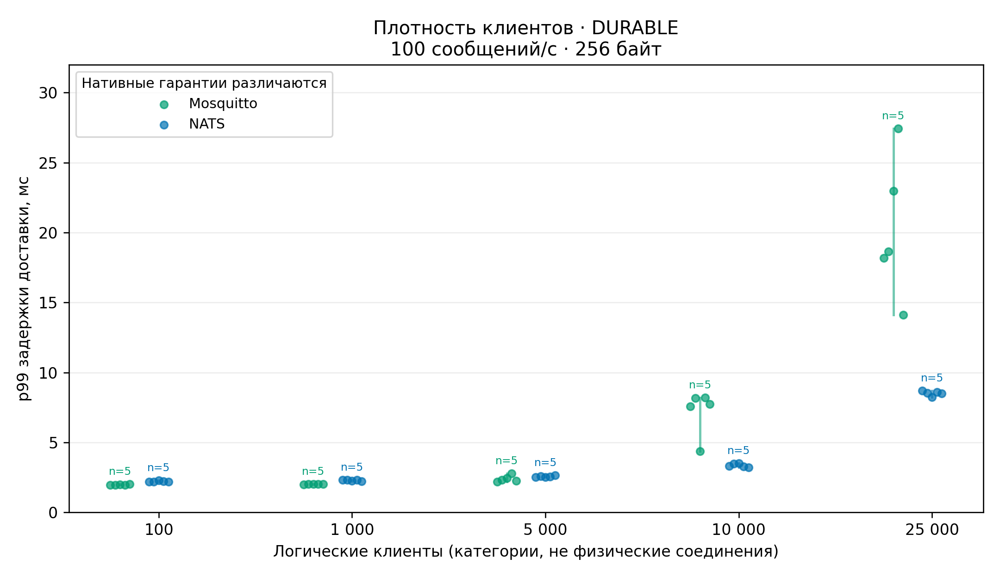

[SVG](density-durable-p99.svg). Точки — отдельные проверенные запуски; вертикальный отрезок — минимум–максимум внутри строгой группы повторений. n — число запусков, не сообщений. Категории по горизонтали расположены равномерно. Это распределение **per-run p99**, а не p99 объединённого потока. Сравнение относится к указанному workload и нативным гарантиям профиля. При нулевой доставке latency отсутствует; отсутствие точки не означает нулевую задержку.

### Фактически предложено, сообщений/с — DURABLE

[SVG](density-durable-offered_rate.svg). Точки — отдельные проверенные запуски; вертикальный отрезок — минимум–максимум внутри строгой группы повторений. n — число запусков, не сообщений. Категории по горизонтали расположены равномерно. Сравнение относится к указанному workload и нативным гарантиям профиля. При нулевой доставке latency отсутствует; отсутствие точки не означает нулевую задержку.

### Успешные publish по клиентскому API, сообщений/с — DURABLE

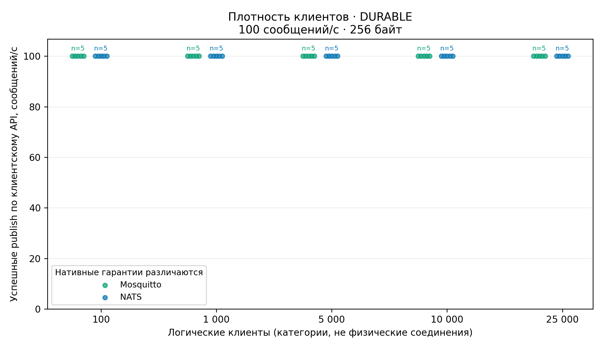

[SVG](density-durable-accepted_rate.svg). Точки — отдельные проверенные запуски; вертикальный отрезок — минимум–максимум внутри строгой группы повторений. n — число запусков, не сообщений. Категории по горизонтали расположены равномерно. Сравнение относится к указанному workload и нативным гарантиям профиля. При нулевой доставке latency отсутствует; отсутствие точки не означает нулевую задержку.

### Доставлено в окне MEASURE, копий/с — DURABLE

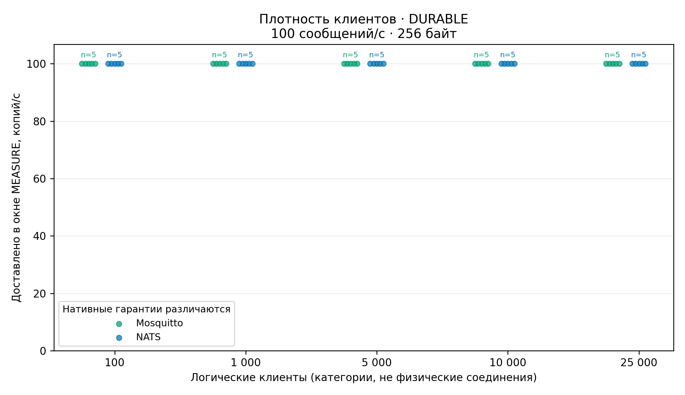

[SVG](density-durable-delivered_rate.svg). Точки — отдельные проверенные запуски; вертикальный отрезок — минимум–максимум внутри строгой группы повторений. n — число запусков, не сообщений. Категории по горизонтали расположены равномерно. Сравнение относится к указанному workload и нативным гарантиям профиля. При нулевой доставке latency отсутствует; отсутствие точки не означает нулевую задержку.

### Средний RSS процесса брокера, МиБ — DURABLE

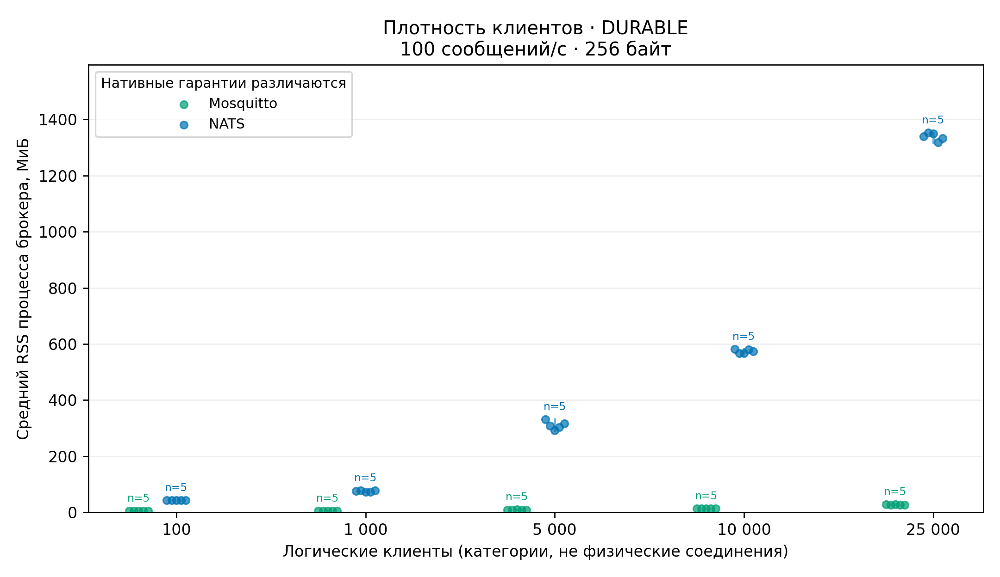

[SVG](density-durable-rss_mean.svg). Точки — отдельные проверенные запуски; вертикальный отрезок — минимум–максимум внутри строгой группы повторений. n — число запусков, не сообщений. Категории по горизонтали расположены равномерно. Сравнение относится к указанному workload и нативным гарантиям профиля. При нулевой доставке latency отсутствует; отсутствие точки не означает нулевую задержку.

### Средняя загрузка брокера, % одного ядра — DURABLE

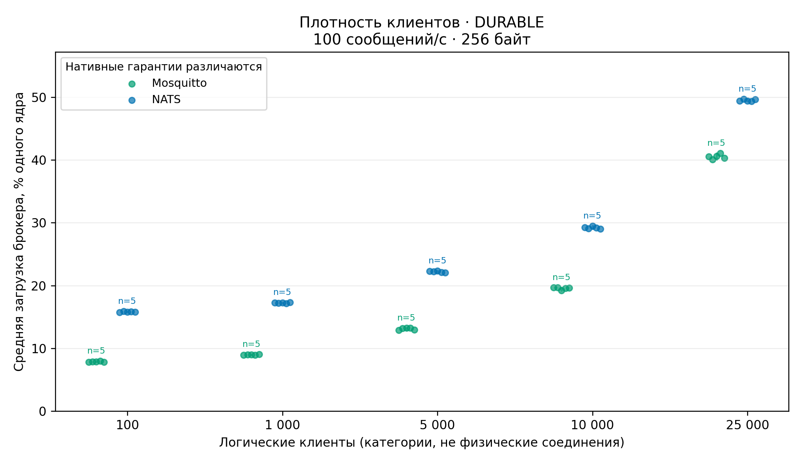

[SVG](density-durable-cpu_mean.svg). Точки — отдельные проверенные запуски; вертикальный отрезок — минимум–максимум внутри строгой группы повторений. n — число запусков, не сообщений. Категории по горизонтали расположены равномерно. Сравнение относится к указанному workload и нативным гарантиям профиля. При нулевой доставке latency отсутствует; отсутствие точки не означает нулевую задержку.

### TCP-соединения брокера (максимум выборок) — DURABLE

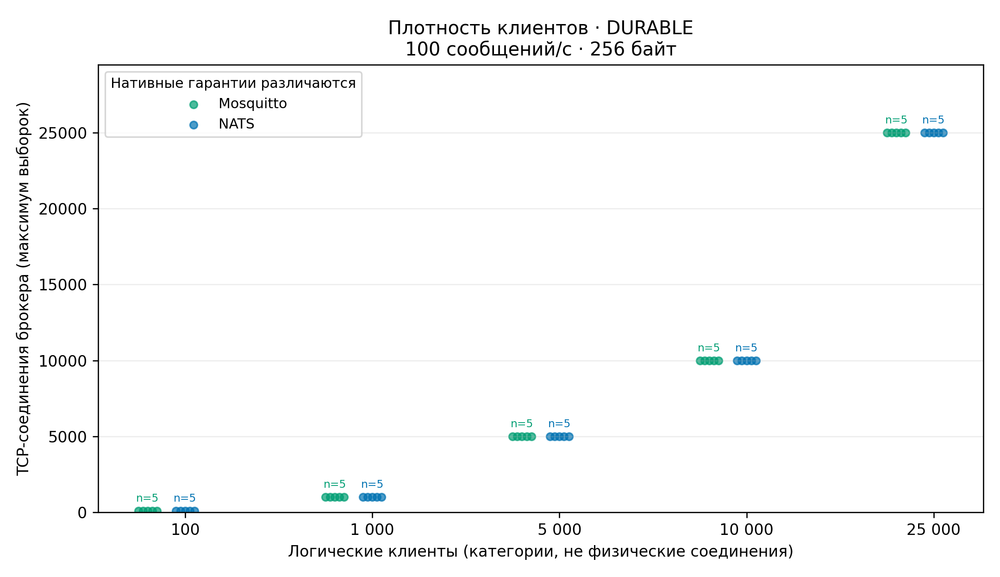

[SVG](density-durable-connections.svg). Точки — отдельные проверенные запуски; вертикальный отрезок — минимум–максимум внутри строгой группы повторений. n — число запусков, не сообщений. Категории по горизонтали расположены равномерно. Сравнение относится к указанному workload и нативным гарантиям профиля. При нулевой доставке latency отсутствует; отсутствие точки не означает нулевую задержку.

### Средняя загрузка генератора, % одного ядра — DURABLE

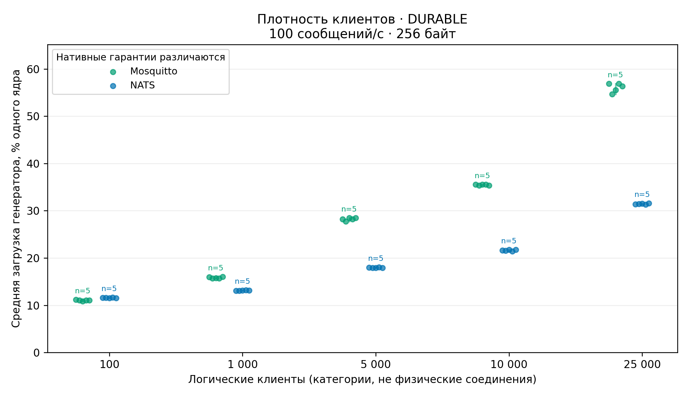

[SVG](density-durable-generator_cpu_mean.svg). Точки — отдельные проверенные запуски; вертикальный отрезок — минимум–максимум внутри строгой группы повторений. n — число запусков, не сообщений. Категории по горизонтали расположены равномерно. Сравнение относится к указанному workload и нативным гарантиям профиля. При нулевой доставке latency отсутствует; отсутствие точки не означает нулевую задержку.

### Недоставленные к концу cooldown копии — DURABLE

[SVG](density-durable-lost.svg). Точки — отдельные проверенные запуски; вертикальный отрезок — минимум–максимум внутри строгой группы повторений. n — число запусков, не сообщений. Категории по горизонтали расположены равномерно. Сравнение относится к указанному workload и нативным гарантиям профиля. При нулевой доставке latency отсутствует; отсутствие точки не означает нулевую задержку.

### Задания, отброшенные до Publish, сообщений — DURABLE

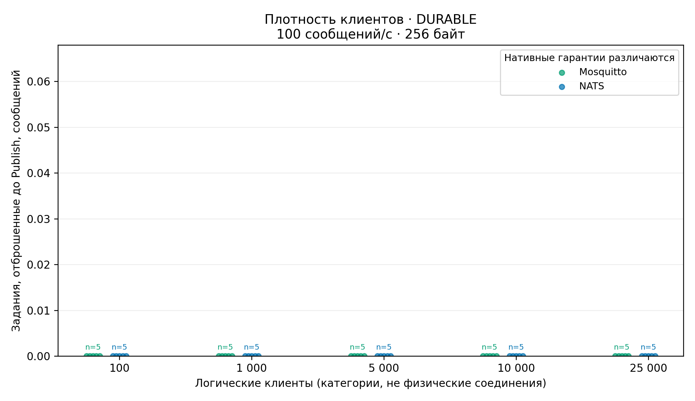

[SVG](density-durable-queue_dropped.svg). Точки — отдельные проверенные запуски; вертикальный отрезок — минимум–максимум внутри строгой группы повторений. n — число запусков, не сообщений. Категории по горизонтали расположены равномерно. Сравнение относится к указанному workload и нативным гарантиям профиля. При нулевой доставке latency отсутствует; отсутствие точки не означает нулевую задержку.

### p99 задержки доставки, мс — FAST

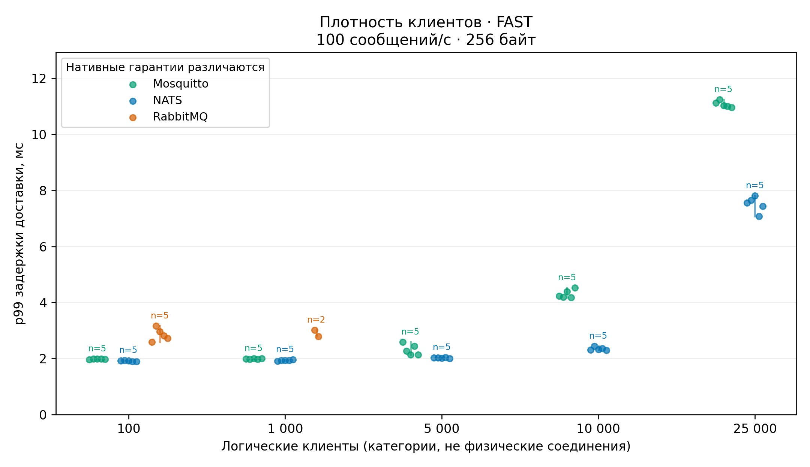

[SVG](density-fast-p99.svg). Точки — отдельные проверенные запуски; вертикальный отрезок — минимум–максимум внутри строгой группы повторений. n — число запусков, не сообщений. Категории по горизонтали расположены равномерно. Это распределение **per-run p99**, а не p99 объединённого потока. Сравнение относится к указанному workload и нативным гарантиям профиля. При нулевой доставке latency отсутствует; отсутствие точки не означает нулевую задержку.

### Фактически предложено, сообщений/с — FAST

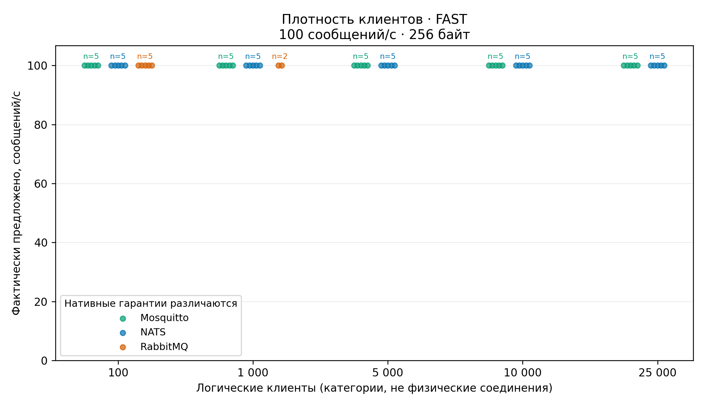

[SVG](density-fast-offered_rate.svg). Точки — отдельные проверенные запуски; вертикальный отрезок — минимум–максимум внутри строгой группы повторений. n — число запусков, не сообщений. Категории по горизонтали расположены равномерно. Сравнение относится к указанному workload и нативным гарантиям профиля. При нулевой доставке latency отсутствует; отсутствие точки не означает нулевую задержку.

### Успешные publish по клиентскому API, сообщений/с — FAST

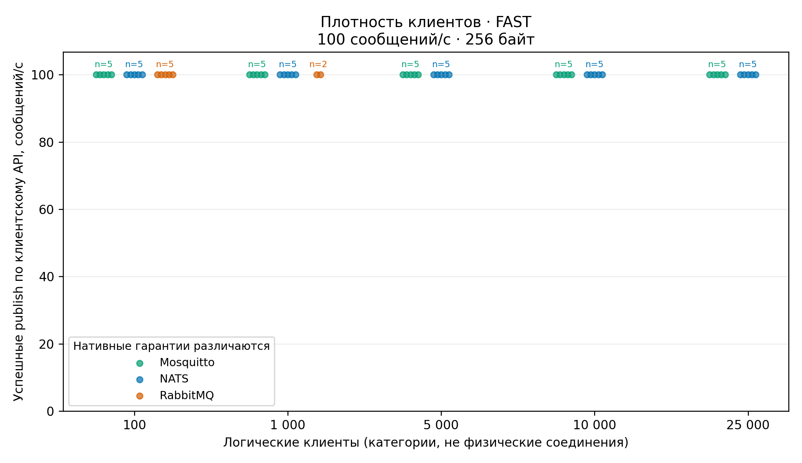

[SVG](density-fast-accepted_rate.svg). Точки — отдельные проверенные запуски; вертикальный отрезок — минимум–максимум внутри строгой группы повторений. n — число запусков, не сообщений. Категории по горизонтали расположены равномерно. Сравнение относится к указанному workload и нативным гарантиям профиля. При нулевой доставке latency отсутствует; отсутствие точки не означает нулевую задержку.

### Доставлено в окне MEASURE, копий/с — FAST

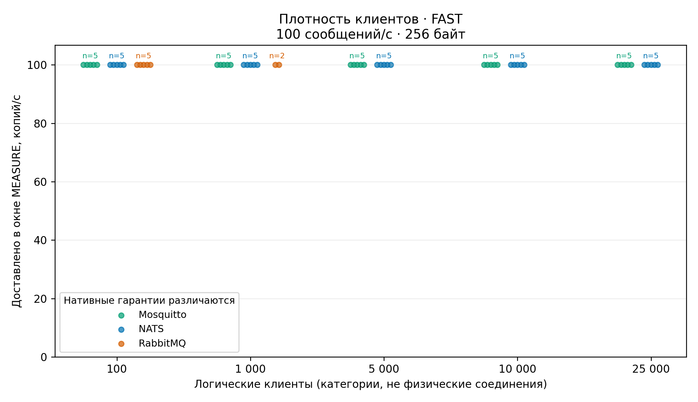

[SVG](density-fast-delivered_rate.svg). Точки — отдельные проверенные запуски; вертикальный отрезок — минимум–максимум внутри строгой группы повторений. n — число запусков, не сообщений. Категории по горизонтали расположены равномерно. Сравнение относится к указанному workload и нативным гарантиям профиля. При нулевой доставке latency отсутствует; отсутствие точки не означает нулевую задержку.

### Средний RSS процесса брокера, МиБ — FAST

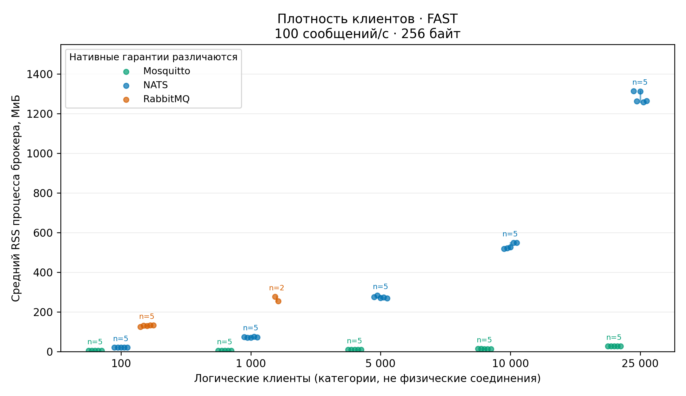

[SVG](density-fast-rss_mean.svg). Точки — отдельные проверенные запуски; вертикальный отрезок — минимум–максимум внутри строгой группы повторений. n — число запусков, не сообщений. Категории по горизонтали расположены равномерно. Сравнение относится к указанному workload и нативным гарантиям профиля. При нулевой доставке latency отсутствует; отсутствие точки не означает нулевую задержку.

### Средняя загрузка брокера, % одного ядра — FAST

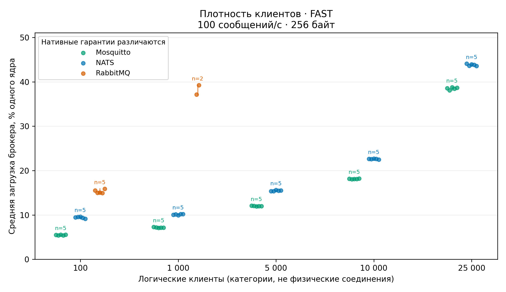

[SVG](density-fast-cpu_mean.svg). Точки — отдельные проверенные запуски; вертикальный отрезок — минимум–максимум внутри строгой группы повторений. n — число запусков, не сообщений. Категории по горизонтали расположены равномерно. Сравнение относится к указанному workload и нативным гарантиям профиля. При нулевой доставке latency отсутствует; отсутствие точки не означает нулевую задержку.

### TCP-соединения брокера (максимум выборок) — FAST

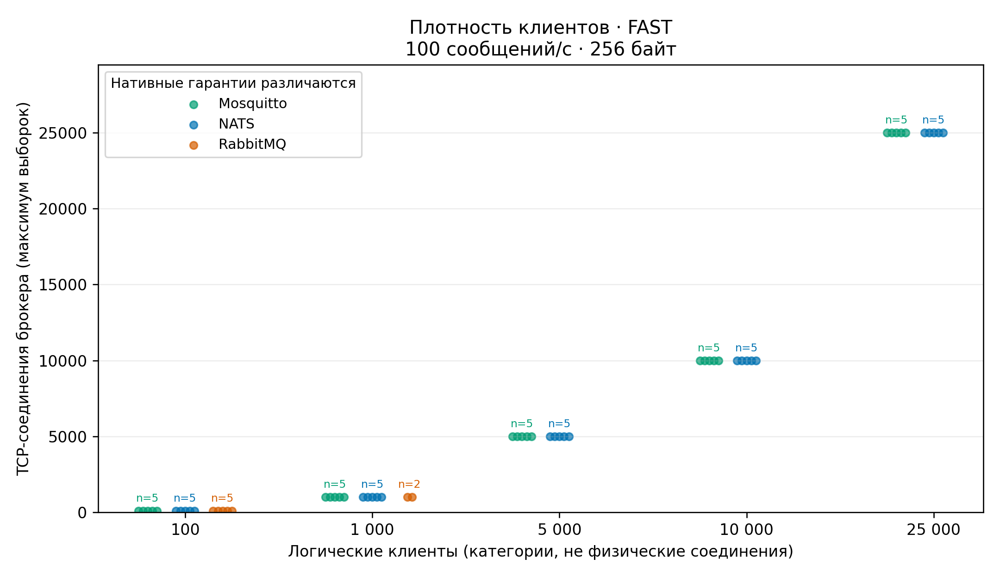

[SVG](density-fast-connections.svg). Точки — отдельные проверенные запуски; вертикальный отрезок — минимум–максимум внутри строгой группы повторений. n — число запусков, не сообщений. Категории по горизонтали расположены равномерно. Сравнение относится к указанному workload и нативным гарантиям профиля. При нулевой доставке latency отсутствует; отсутствие точки не означает нулевую задержку.

### Средняя загрузка генератора, % одного ядра — FAST

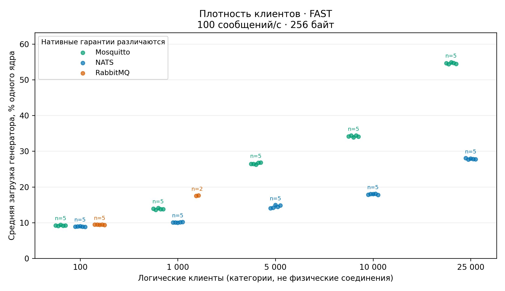

[SVG](density-fast-generator_cpu_mean.svg). Точки — отдельные проверенные запуски; вертикальный отрезок — минимум–максимум внутри строгой группы повторений. n — число запусков, не сообщений. Категории по горизонтали расположены равномерно. Сравнение относится к указанному workload и нативным гарантиям профиля. При нулевой доставке latency отсутствует; отсутствие точки не означает нулевую задержку.

### Недоставленные к концу cooldown копии — FAST

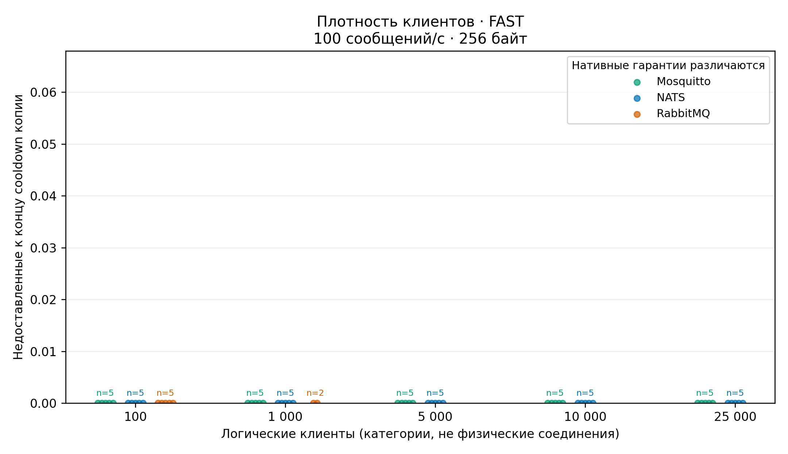

[SVG](density-fast-lost.svg). Точки — отдельные проверенные запуски; вертикальный отрезок — минимум–максимум внутри строгой группы повторений. n — число запусков, не сообщений. Категории по горизонтали расположены равномерно. Сравнение относится к указанному workload и нативным гарантиям профиля. При нулевой доставке latency отсутствует; отсутствие точки не означает нулевую задержку.

### Задания, отброшенные до Publish, сообщений — FAST

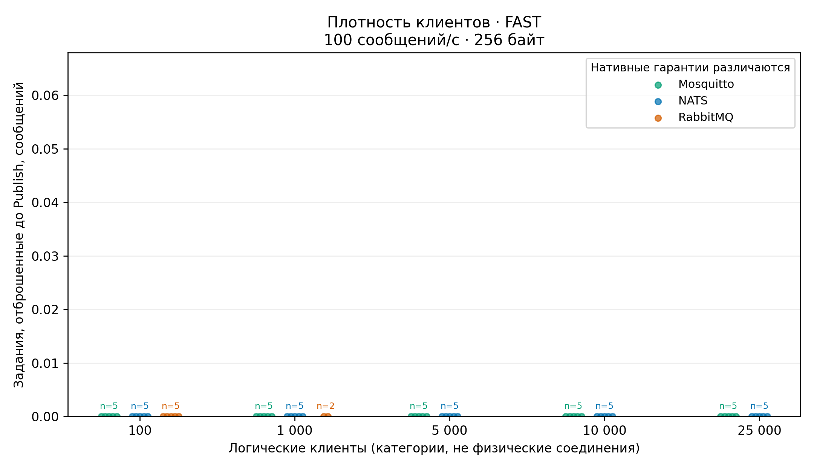

[SVG](density-fast-queue_dropped.svg). Точки — отдельные проверенные запуски; вертикальный отрезок — минимум–максимум внутри строгой группы повторений. n — число запусков, не сообщений. Категории по горизонтали расположены равномерно. Сравнение относится к указанному workload и нативным гарантиям профиля. При нулевой доставке latency отсутствует; отсутствие точки не означает нулевую задержку.

### p99 задержки доставки, мс — FAST · НЕХВАТКА ДИСКА, вне основного сравнения

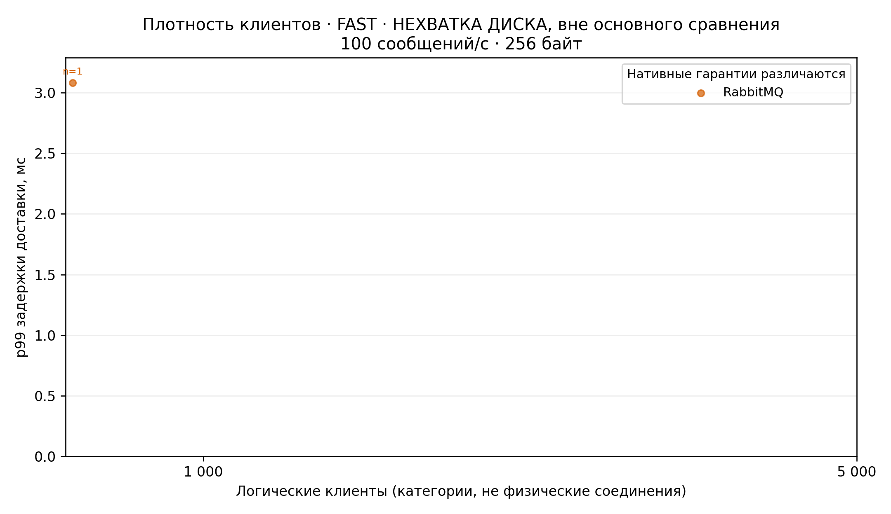

[SVG](density-fast-disk-pressure-p99.svg). Точки — отдельные проверенные запуски; вертикальный отрезок — минимум–максимум внутри строгой группы повторений. n — число запусков, не сообщений. Категории по горизонтали расположены равномерно. Это распределение **per-run p99**, а не p99 объединённого потока. Сравнение относится к указанному workload и нативным гарантиям профиля. При нулевой доставке latency отсутствует; отсутствие точки не означает нулевую задержку.

### Фактически предложено, сообщений/с — FAST · НЕХВАТКА ДИСКА, вне основного сравнения

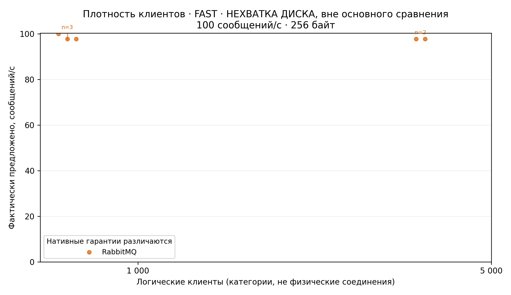

[SVG](density-fast-disk-pressure-offered_rate.svg). Точки — отдельные проверенные запуски; вертикальный отрезок — минимум–максимум внутри строгой группы повторений. n — число запусков, не сообщений. Категории по горизонтали расположены равномерно. Сравнение относится к указанному workload и нативным гарантиям профиля. При нулевой доставке latency отсутствует; отсутствие точки не означает нулевую задержку.

### Успешные publish по клиентскому API, сообщений/с — FAST · НЕХВАТКА ДИСКА, вне основного сравнения

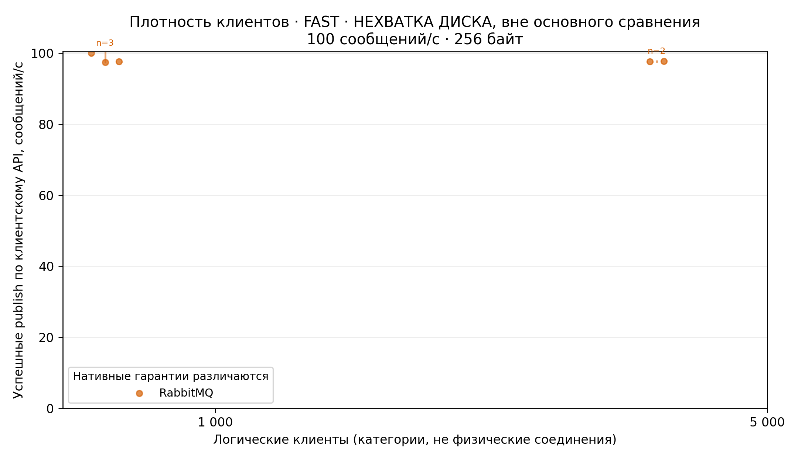

[SVG](density-fast-disk-pressure-accepted_rate.svg). Точки — отдельные проверенные запуски; вертикальный отрезок — минимум–максимум внутри строгой группы повторений. n — число запусков, не сообщений. Категории по горизонтали расположены равномерно. Сравнение относится к указанному workload и нативным гарантиям профиля. При нулевой доставке latency отсутствует; отсутствие точки не означает нулевую задержку.

### Доставлено в окне MEASURE, копий/с — FAST · НЕХВАТКА ДИСКА, вне основного сравнения

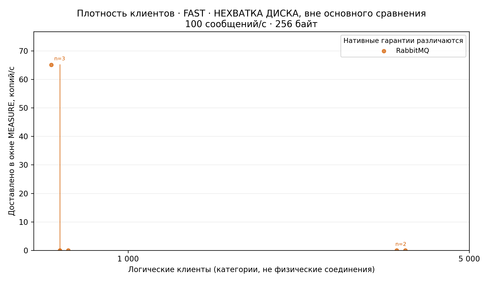

[SVG](density-fast-disk-pressure-delivered_rate.svg). Точки — отдельные проверенные запуски; вертикальный отрезок — минимум–максимум внутри строгой группы повторений. n — число запусков, не сообщений. Категории по горизонтали расположены равномерно. Сравнение относится к указанному workload и нативным гарантиям профиля. При нулевой доставке latency отсутствует; отсутствие точки не означает нулевую задержку.

### Средний RSS процесса брокера, МиБ — FAST · НЕХВАТКА ДИСКА, вне основного сравнения

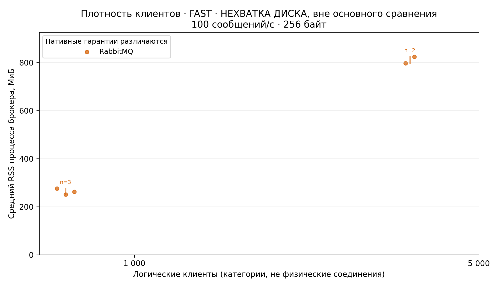

[SVG](density-fast-disk-pressure-rss_mean.svg). Точки — отдельные проверенные запуски; вертикальный отрезок — минимум–максимум внутри строгой группы повторений. n — число запусков, не сообщений. Категории по горизонтали расположены равномерно. Сравнение относится к указанному workload и нативным гарантиям профиля. При нулевой доставке latency отсутствует; отсутствие точки не означает нулевую задержку.

### Средняя загрузка брокера, % одного ядра — FAST · НЕХВАТКА ДИСКА, вне основного сравнения

[SVG](density-fast-disk-pressure-cpu_mean.svg). Точки — отдельные проверенные запуски; вертикальный отрезок — минимум–максимум внутри строгой группы повторений. n — число запусков, не сообщений. Категории по горизонтали расположены равномерно. Сравнение относится к указанному workload и нативным гарантиям профиля. При нулевой доставке latency отсутствует; отсутствие точки не означает нулевую задержку.

### TCP-соединения брокера (максимум выборок) — FAST · НЕХВАТКА ДИСКА, вне основного сравнения

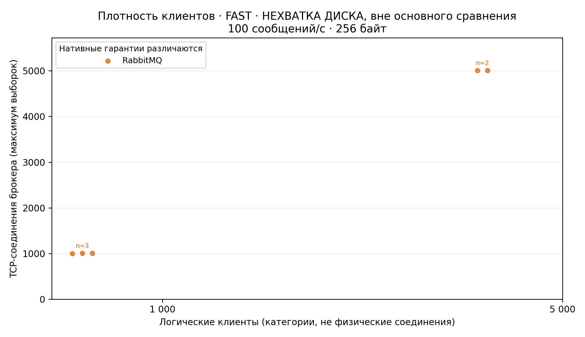

[SVG](density-fast-disk-pressure-connections.svg). Точки — отдельные проверенные запуски; вертикальный отрезок — минимум–максимум внутри строгой группы повторений. n — число запусков, не сообщений. Категории по горизонтали расположены равномерно. Сравнение относится к указанному workload и нативным гарантиям профиля. При нулевой доставке latency отсутствует; отсутствие точки не означает нулевую задержку.

### Средняя загрузка генератора, % одного ядра — FAST · НЕХВАТКА ДИСКА, вне основного сравнения

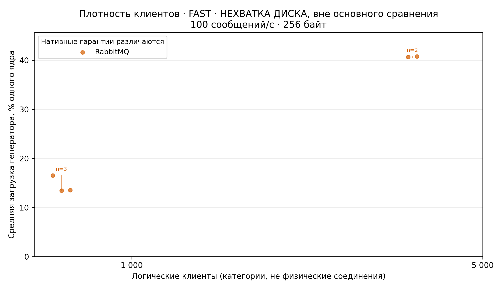

[SVG](density-fast-disk-pressure-generator_cpu_mean.svg). Точки — отдельные проверенные запуски; вертикальный отрезок — минимум–максимум внутри строгой группы повторений. n — число запусков, не сообщений. Категории по горизонтали расположены равномерно. Сравнение относится к указанному workload и нативным гарантиям профиля. При нулевой доставке latency отсутствует; отсутствие точки не означает нулевую задержку.

### Недоставленные к концу cooldown копии — FAST · НЕХВАТКА ДИСКА, вне основного сравнения

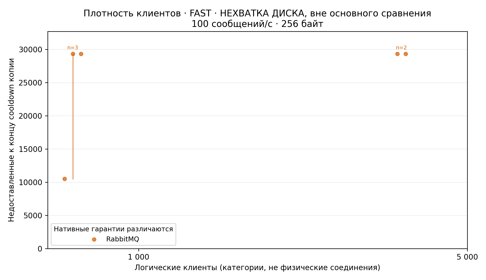

[SVG](density-fast-disk-pressure-lost.svg). Точки — отдельные проверенные запуски; вертикальный отрезок — минимум–максимум внутри строгой группы повторений. n — число запусков, не сообщений. Категории по горизонтали расположены равномерно. Сравнение относится к указанному workload и нативным гарантиям профиля. При нулевой доставке latency отсутствует; отсутствие точки не означает нулевую задержку.

### Задания, отброшенные до Publish, сообщений — FAST · НЕХВАТКА ДИСКА, вне основного сравнения

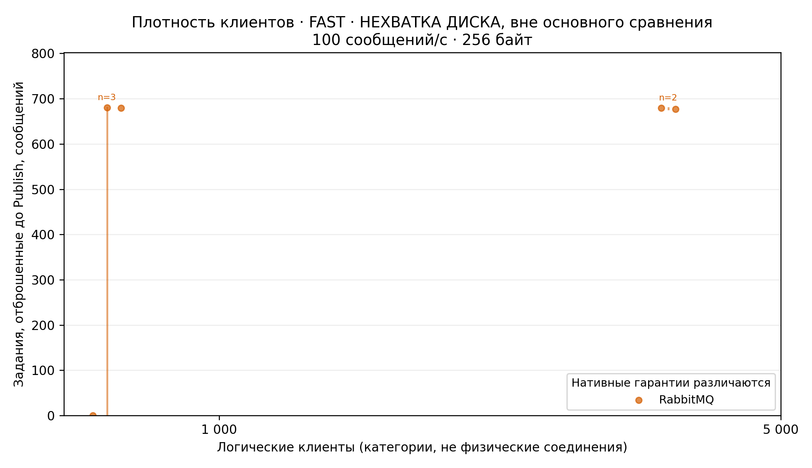

[SVG](density-fast-disk-pressure-queue_dropped.svg). Точки — отдельные проверенные запуски; вертикальный отрезок — минимум–максимум внутри строгой группы повторений. n — число запусков, не сообщений. Категории по горизонтали расположены равномерно. Сравнение относится к указанному workload и нативным гарантиям профиля. При нулевой доставке latency отсутствует; отсутствие точки не означает нулевую задержку.

### Разведочная интенсивность — NATS

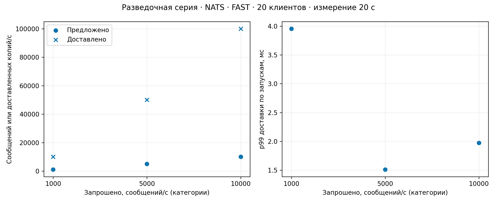

[SVG](exploratory-rate-nats-fast-cb667f5e.svg). Всего n=3 отдельных проверенных запусков с одинаковыми параметрами вне запрошенного rate. Это короткая вспомогательная серия, не финальная baseline и не доказательство capacity. Показаны только прошедшие строгую проверку запуски; другие попытки и причины исключения есть в реестре.

### Разведочная интенсивность — Mosquitto

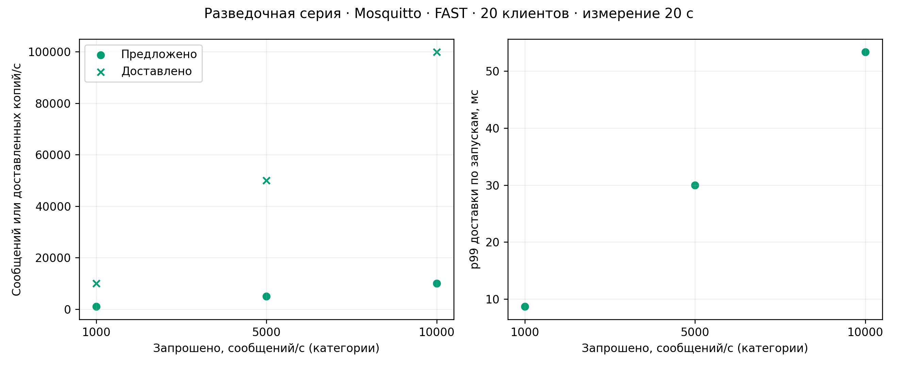

[SVG](exploratory-rate-mosquitto-fast-a5753949.svg). Всего n=3 отдельных проверенных запусков с одинаковыми параметрами вне запрошенного rate. Это короткая вспомогательная серия, не финальная baseline и не доказательство capacity. Показаны только прошедшие строгую проверку запуски; другие попытки и причины исключения есть в реестре.

### Разведочная интенсивность — RabbitMQ

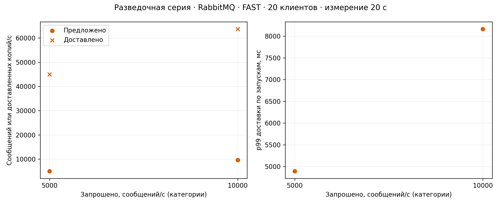

[SVG](exploratory-rate-rabbitmq-fast-fe12cdef.svg). Всего n=2 отдельных проверенных запусков с одинаковыми параметрами вне запрошенного rate. Это короткая вспомогательная серия, не финальная baseline и не доказательство capacity. Показаны только прошедшие строгую проверку запуски; другие попытки и причины исключения есть в реестре.

### Разведочная интенсивность — Kafka

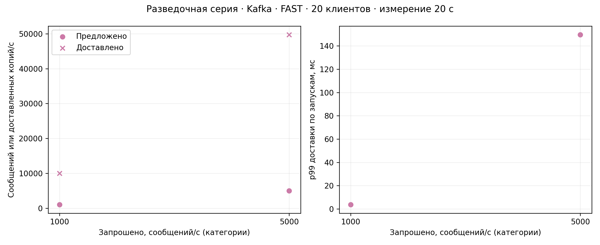

[SVG](exploratory-rate-kafka-fast-103481c1.svg). Всего n=2 отдельных проверенных запусков с одинаковыми параметрами вне запрошенного rate. Это короткая вспомогательная серия, не финальная baseline и не доказательство capacity. Показаны только прошедшие строгую проверку запуски; другие попытки и причины исключения есть в реестре.

### Разведочная интенсивность — NATS

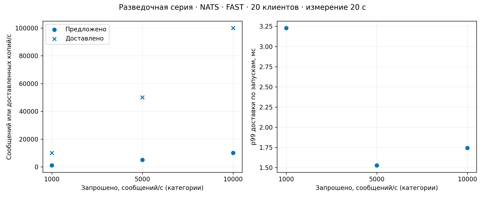

[SVG](exploratory-rate-nats-fast-452e997f.svg). Всего n=3 отдельных проверенных запусков с одинаковыми параметрами вне запрошенного rate. Это короткая вспомогательная серия, не финальная baseline и не доказательство capacity. Показаны только прошедшие строгую проверку запуски; другие попытки и причины исключения есть в реестре.
